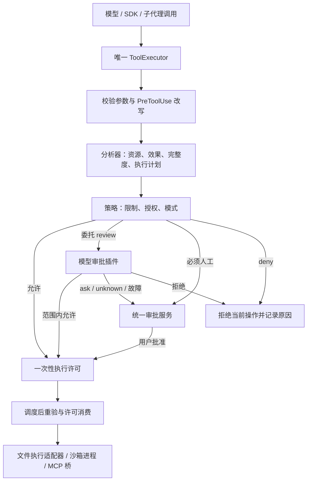

# 权限体系改造方案

状态：权限 v3 已按本方案落地主要运行链路，实际语义以 [POLICY.md](POLICY.md) 为准。本文保留原设计与扩展目标，不能把所有目标视为已实现。

已实现：任务/会话/项目 Grant、完整参数绑定、目录授权、跨工具资源规则、统一审批动作、普通拒绝与整任务停止、项目授权保存/撤销、启动信任、MCP 最小环境和连接身份、旧会话显式迁移，以及可选 Linux 项目副本隔离。

执行隔离采用不回写的项目副本，未实现直接可写工作区、联网域名授权、依赖目录挂载或 Windows/macOS adapter。工具效果仍沿用现有 read/write 等契约，未将 create/update/delete 完全拆分；已有工具规则保留现有文本格式，资源规则使用结构化数据。这些边界不会通过模型 allow 自动扩大。

## 1. 目标与设计结论

权限体系需要让用户回答清楚三个问题：我授权了什么，为什么这次还要询问，拒绝以后会发生什么。

建议保留唯一 ToolExecutor、确定性分析、最终参数绑定与执行前重验，围绕它们建立明确的授权对象、统一审批协议和可选择的执行隔离。模型审批保留为插件，只在策略指定的范围内辅助判断，不负责创造授权。

完成后的体验：

- 项目内普通读取、搜索直接执行；明确授权的目录写入可以连续执行。
- `ask`、`auto`、`yolo` 各有清楚、可测试的含义。
- 运行测试和构建可以授权一个明确的执行环境，不必逐条审批重复命令。
- 敏感访问、危险操作、越界和明确 ask 继续进入人工审批；deny 继续优先。
- “允许一次”“本任务允许”“本会话允许”“保存项目规则”各有独立、真实的作用域。
- 拒绝普通操作以后可以继续安全地完成其他工作；停止任务是明确的另一项操作。
- CLI、App、远程宿主使用同一组后端动作和原因数据。

## 2. 当前问题与代码依据

| 问题                           | 当前实现                                                                                               | 影响                                                            |
| ------------------------------ | ------------------------------------------------------------------------------------------------------ | --------------------------------------------------------------- |
| 模式差异难理解                 | `src/builtin/policy/index.ts`：ask 和 auto 的兜底均为 `review_uncertain`，ask 又提前于 writeRoots 返回 | 用户选择 ask 仍可能由模型放行；显式目录授权在不同模式下表现不同 |
| 规则可保存却未必有放行资格     | 同文件 `literalTarget()` 和多处分支；文件宽泛 allow 大多不能直接授权，Windows 还有单独约束             | 设置页显示“允许”，实际仍反复审批                                |
| 记忆范围没有成为正式契约       | `src/core/tool-executor.ts` 的 `remember()` 只取 `patternTarget`，文件通常是路径，Shell 是命令         | 路径级授权、命令级授权和完整参数级授权容易混淆                  |
| 项目记忆协议与实际持久化不一致 | `UserDecision` 接受 `remember: 'project'`，`remember()` 实际仅加会话规则并发出手工保存提示             | SDK 调用者不能从返回值确认项目规则是否保存                      |
| 前端承担了权限推理             | `src/cli/app.ts` 的 `canRememberPermission()` 根据 reason code 白名单猜测记忆能否生效                  | 新增策略分支容易导致 UI 与实际授权不一致                        |
| App 审批动作较少               | `desktop/renderer/App.tsx` 的审批提交只含 allow/feedback                                               | App 与 CLI 缺少一致的授权范围选择                               |
| deny 默认扩大到整请求          | `src/core/tool-executor.ts` 多处调用 `requestPermission.deny()`；仅少量策略拒绝标明 invocation         | 一个模型误判或一个被禁止的操作可能阻止后续安全工作              |
| 未知程序的执行边界较宽         | `src/tools/bash.ts` 普通路径继承宿主环境执行；`reviewer-model/model.ts` 允许对部分不完整分析给 allow   | 通过审批不等于程序真的只能访问已讨论的资源                      |
| 工具审批晚于部分能力启动       | `src/runtime/create-agent.ts` 动态导入 pluginEntries；`src/mcp/plugin.ts` 启动 stdio server 并继承环境 | 项目提供的执行入口需要在导入/启动之前建立信任                   |
| 约束与适配交织                 | `src/builtin/policy/index.ts` 同时处理规则、工具身份、平台限制、目录授权、模式                         | 每加一项能力就增加分支，难以解释和穷举验证                      |

这些是行为与结构问题。已有代码已经对真实路径、符号链接、硬链接、敏感文件、工具身份、取消、并发和审批过期做了较多防护，应作为回归基础保留。

## 3. 信任边界

### 3.1 授权来源

授权只能来自宿主认可的用户操作、受信任配置或宿主提供的 SDK 会话配置。以下内容只能作为任务数据：模型输出、工具结果、仓库说明、skill 正文、MCP 描述、摘要、子代理自述。

自然语言任务可作为 reviewer 判断相关性的证据，不能自动生成永久规则、扩大文件范围或解除网络限制。计划获批只表示同意计划；其中真实操作仍使用权限体系。

### 3.2 项目信任必须早于执行入口

启动顺序调整为：

1. 读取配置为纯数据，保留每个字段的来源。
2. 识别可能扩大权限或执行代码的项目字段：pluginEntries、MCP 启动命令、权限 allow、模型端点及凭据路由等。
3. 由宿主的信任记录决定是否激活这些字段。
4. 再解析凭据、导入插件、运行 setup、启动 MCP、建立模型连接。

未知项目可以进入受限阅读状态；执行型插件和 MCP 保持未激活。首次信任展示实际路径、启动入口、端点和请求的环境变量名称，批准绑定这些内容。新增入口或变更端点需要新的信任决定，普通源码改动不触发整项目重新确认。

内置 preset 是宿主信任根；外部插件执行与其依赖属于安装信任范围。不能靠 manifest 声明证明任意依赖代码安全。批准本地开发插件时应明确其拥有进程内代码权限，不能把展示的摘要误称为完整代码证明。

信任记录由宿主管理，绑定 canonical 项目路径、执行宿主身份及所批准的配置指纹。项目文件不能自行写入宿主信任记录。已有版本升级也不能把所有历史项目直接视为已授权新能力。

### 3.3 工具权限与宿主权限

- 进程内插件是受信任代码，可以直接调用 Node API；ToolExecutor 约束受支持的工具调用路径。
- 防范不受信任插件直接访问文件系统，需要独立进程和进程隔离，是后续扩展，不能宣称现有插件接口已经做到。
- 模型请求由 provider 宿主使用批准的端点和凭据；这项网络能力不传递给 shell。
- MCP 的工具调用授权与 MCP 服务启动授权分开。远程 MCP 的实际副作用由远端决定，本地沙箱不能约束远端数据库或邮件操作。
- 远程项目必须由执行所在宿主重新校验授权，本机项目路径和本机授权不自动通用于 SSH 宿主。

## 4. 分层架构



职责分配：

| 层                 | 职责                                               | 建议位置                                            |
| ------------------ | -------------------------------------------------- | --------------------------------------------------- |
| 通用执行协议       | 单次调用生命周期、参数冻结、取消、一次性许可、事件 | `src/core/permission/`、`src/core/tool-executor.ts` |
| 默认授权策略插件   | 规则优先级、模式、敏感资源、危险判定、平台约束     | `src/builtin/policy/`                               |
| 分析器插件         | 已知工具与平台的事实分析，不作用户授权决定         | 默认分析器逐步拆分为可注册的语义适配器              |
| 授权存储与配置插件 | 任务/会话授权、项目/全局规则、CAS 保存             | builtin 配置与存储实现，通过 SDK 装配               |
| 模型审批插件       | 根据完整证据返回单次意见                           | `src/builtin/reviewer-model/`                       |
| 执行隔离插件       | 启动受限制进程、报告实际支持能力                   | 新执行能力，经 `Plugin.setup(ctx)` 注册             |
| UI                 | 渲染后端给出的审批动作、提交动作 ID                | `src/cli/`、`desktop/renderer/`                     |

core 不导入具体 shell、OS 沙箱或工具实现。新增执行与授权能力先定义 SDK 契约，再通过同一注册表装配。宿主传入的硬边界是通用约束数据，策略插件无法在受支持调用路径里将其扩大。

## 5. 一等公民：操作、约束、授权与执行许可

### 5.1 操作描述 OperationDescriptor

由最终参数生成不可变操作描述，至少包含：

- 调用身份：host、project、session、rootRequest、agent、run、call。
- 工具身份：capabilityId、ownerPlugin、实现版本、schema 指纹；MCP 额外含服务与连接身份。
- 完整参数指纹、cwd、分析器身份与版本。
- `effects`：read、create、update、delete、execute、network、unknown。
- `resources`：文件真实路径及类型、进程入口与 argv、网络目标、远端资源标识。
- 分析完整度、尚未解决的语义、平台实际可验证能力。
- 执行计划及可重验的环境依赖。

资源位置与敏感性分开表达。例如“项目内 .env”同时是 project 和 credential，不使用一个 scope 枚举互相覆盖。证据标明宿主验证、用户批准或工具自报，工具自报不能直接成为自动放行事实。

逐步用类型化的 executionPlan、filesystemSnapshot、platformCapabilities 替代 `$shellContract` 等字符串环境字段，减少策略和工具间隐含约定。

### 5.2 约束 Constraint

约束表达不能因普通授权而消失的限制，分为：

- `deny`：当前有效规则禁止，结束相关操作，审批按钮不能绕过。
- `mustAsk`：危险操作、敏感目标、项目外访问、明确 ask、未验证平台语义等，必须人工批准当前调用。
- `executionBoundary`：宿主文件、网络、进程限制。普通允许一次不能改变这层边界；扩大边界是单独且明确的动作。

“必须人工”与“永久禁止”分别建模。保留 AGENTS.md 要求的 deny、危险检测、明确 ask 优先级，yolo 和模型 allow 均不能越过。

### 5.3 授权 Grant

Grant 是范围明确的许可，不是历史审批缓存。

| 范围    | 生命周期                                         | 示例                            |
| ------- | ------------------------------------------------ | ------------------------------- |
| once    | 本次调用消费一次                                 | 允许当前完整命令                |
| task    | 当前宿主认定的根用户请求及明确委派，任务结束撤销 | 本任务修改 `src/` 与 `tests/`   |
| session | 当前会话，默认不因加载聊天历史自动恢复           | 本会话在项目受限环境内运行测试  |
| project | 持久化规则，绑定项目和宿主                       | 允许已验证文件工具修改 `src/**` |
| global  | 用户设置页中明确保存                             | 对所有受信任项目适用的限制规则  |

Grant 包含：ID、创建者、来源、作用域、项目/宿主、工具身份选择器、资源选择器、effects、执行环境、撤销状态及可选过期时间。

两类记忆必须区分：

- “相同完整调用”：绑定规范化后的全部 JSON 参数、工具身份和 cwd。
- “此范围内的操作”：例如允许 update/create `src/**`，可以改变文件内容，但不能变成删除、越界或执行程序。

不再把一个 patternTarget 同时当作这两种授权。规则必须覆盖所有实际 effects 和资源，覆盖其中一个目标不代表覆盖整条调用。

### 5.4 执行许可 ExecutionPermit

策略和审批最终形成一次性许可，绑定：调用 ID、最终参数、工具身份、当前约束、适用 Grant、分析和执行计划、环境、策略版本、任务代际及取消状态。

Permit 由 executor 创建和消费，模型、工具参数、renderer 均不能提交自造 Permit。消费点仍在调度完成与最终重验之后。允许结果不能跨调用复用；Grant 的再次匹配每次都重新检查约束和环境。

## 6. 确定性的判定顺序

1. 校验 JSON/schema，运行参数改写钩子，再校验并冻结。
2. 验证宿主、会话、任务、工具身份、取消状态和执行约束。
3. 检查可在原始调用上确定的 deny。
4. 分析真实资源、整条命令与全部 effects；继续匹配真实资源上的 deny。
5. 生成危险、敏感、越界、明确 ask 和平台不确定等 `mustAsk` 约束。
6. 有 deny 立即拒绝；有 mustAsk 只提供适用的人工动作。
7. 匹配现有 Grant，要求覆盖当前操作全部需求且满足宿主执行边界。
8. 已验证的项目内普通读取和搜索直接允许。
9. 应用模式默认，必要时仅在已确定的执行边界内调用 reviewer。
10. 人工决定或模型意见形成一次性 Permit；调度后重验，消费并执行。

分析失败不会使 deny 消失，也不会成为 reviewer 自动批准的入口。资源无法完整枚举时，只有可强制执行的边界能提供相应范围保证；未知 MCP 副作用不能借用本地沙箱保证。

### 6.1 模式语义

以下是建议的新行为，属于显式行为变更，不能悄悄替换现有语义。

| 场景                                         | ask（默认） | auto                        | yolo                              |
| -------------------------------------------- | ----------- | --------------------------- | --------------------------------- |
| 已验证项目内普通读取/搜索                    | 允许        | 允许                        | 允许                              |
| 现有 Grant 完整覆盖，且无 mustAsk            | 允许        | 允许                        | 允许                              |
| 完整普通项目写入，未获授权                   | 人工        | 范围可验证时交 reviewer     | 允许                              |
| 已批准边界内的受限进程执行，当前调用未获授权 | 人工        | reviewer 判定与任务是否相关 | 边界可强制执行且无 mustAsk 时允许 |
| 未知程序且无可验证隔离                       | 人工        | 人工                        | 人工                              |
| 未知 MCP 副作用且无明确 Grant                | 人工        | 人工                        | 人工                              |
| 显式 ask、敏感、危险、项目外                 | 人工        | 人工                        | 人工                              |
| deny                                         | 拒绝        | 拒绝                        | 拒绝                              |
| 未验证平台路径/语义                          | 人工        | 人工                        | 人工                              |

`ask` 不再主动委托模型。保留默认安装的 `deterministic` / `model` 能力及默认 ask；模型审批主要用于 auto。显式 writeRoots 转为范围授权后在 ask 中也生效，因为用户已经明确授予该范围。Windows 现有额外写入与路径约束，在平台验收完成前继续作为 mustAsk/受限授权条件保留，不能直接套用通用自动放行行。

`yolo` 省去边界内普通操作的询问，边界扩大仍需明确授权。模式切换不能替已经弹出的审批作答。保存成功后立即应用模式；插件实现及需重启的配置明确显示生效时间。

### 6.2 reviewer 的权限上限

reviewer 接受完整操作、当前真实用户请求、已验证事实、现有授权和可委托的边界。输出仍严格校验，不给执行句柄或授权存储句柄。

- allow：仅能批准策略已标明可委托的当前调用，不能补全缺失资源事实或扩大沙箱。
- deny：拒绝当前操作，默认不锁定整任务，也不自动转人工批准。
- ask/unknown/故障/超时：人工；无 responder 时返回结构化 approval_required。
- 明确 deny、mustAsk、无可信边界的未知操作：不调用 reviewer。

对不完整的 shell 分析，只有宿主已限制实际文件/网络/进程访问时，模型才可判断任务相关性。模型认为 `pnpm test` 很常见不能证明仓库脚本无副作用。

## 7. 规则与配置设计

### 7.1 规则使用结构化语义

内部统一成带版本的规则 AST：action、工具身份、effect、资源选择器、参数条件、执行环境、来源层与稳定 ID。

示例语义：

```json
{
  "id": "project-source-update",
  "action": "allow",
  "tool": { "ownerPlugin": "agentlab.local-tools", "names": ["write_file", "edit_file"] },
  "effects": ["create", "update"],
  "resource": { "kind": "file", "root": "project", "glob": "src/**" }
}
```

这是目标 AST 示例，尚不是可粘贴到当前配置的有效字段。

文件 glob 作用于项目根下规范化资源，并继续检查真实路径和保护目录。Shell 命令文本匹配只能用来限制/筛选调用，不能证明程序只读。命令授权需要完整参数或经用户批准的执行配置；未知工具的工具级 allow 必须说明其潜在全部副作用。

允许目录范围是正式能力。对可验证的内置文件工具，`src/**` 授权应确实工作；配置校验不接受“看起来是 allow、实际必然无效”的规则。受 mustAsk 遮挡时显示具体原因。

### 7.2 层级与限制合并

普通配置继续使用：内置默认 < 全局 < 项目 < SDK 会话覆盖。权限限制另外保留来源和强度：

- deny 采用各有效层的并集；任何普通 allow 不覆盖 deny。
- 明确 ask 采用各有效层的并集；优先于普通授权。
- 授权按身份与资源匹配，不靠数组先后隐式扩大权限。
- SDK 的普通会话覆盖不能靠空数组抹掉上层 deny。宿主如需变更自身安全边界，使用独立的受信任管理入口。
- 项目只能提供自身受信任范围内的授权；仓库提交的规则不会自动变成宿主的全局信任。

### 7.3 生效、撤销与持久化

继续使用原子写、CAS、未知字段保留、安全路径及脱敏错误处理。

- 新规则与删除规则产生明确 revision，在下一次判定边界应用；所有未消费 Permit 重新验证。
- 撤销授权取消相关等待审批和排队执行。已经执行的副作用不能回滚；已运行进程只有 adapter 支持时才能可靠终止，UI 区分“已撤销”与“正在停止”。
- 保存项目授权先完成持久化，再应用内存状态；失败不会显示“已保存”。用户仍可另选一次允许，但不能静默把保存失败伪装成项目授权成功。
- 活动任务 Grant 不进入聊天历史。恢复会话时历史中的批准只作记录；持久规则按当前宿主重新加载。
- 默认不自动恢复临时 session Grant。若以后支持恢复，必须显式选择并重验身份和边界。
- 模式保存仍遵守 CLI 默认项目、App 默认全局、项目覆盖须显式选择的约定。

## 8. Shell 执行与隔离

### 8.1 三类执行

1. 已验证的受控命令计划：延续当前只读 AST、可信工具入口、受控环境和目标绑定。
2. 项目程序、测试与构建：在已批准的受限执行环境内运行，允许动态语言本身，不依赖不断扩充安全命令白名单。
3. 当前宿主无法限制的操作：明确人工审批，展示实际会获得的宿主权限；不能通过 reviewer 自动进入这一路径。

### 8.2 执行环境配置

首个执行配置建议提供：

- 项目普通文件可读；写入仅到批准的项目目录和专用临时目录。
- 凭据、权限配置、插件入口、`.git` 等现有保护目标默认隔离或只读限制。
- 不挂载真实 HOME；仅提供专用 HOME 与明确声明的依赖/缓存路径。
- 默认无网络；网络授权按目标与用途单独提供。域名限制需要代理/出口层落实，不能靠匹配命令字符串或仅看初始 DNS；重定向、代理与私网目的地同样受控。
- 子进程继承同一边界，限制进程树生命周期、超时、输出和可用时的资源预算。
- 最小环境变量；模型 API key、MCP token、系统凭据不自动继承给仓库程序。

本地 MCP 也改成显式环境变量传递；先展示将传递的变量名，再由宿主取值，不把秘密值送到 UI 或日志。

每个平台 adapter 必须报告实际支持的文件、网络、进程限制。宿主启动时探测，并用无害探针验证限制有效。文件描述符、继承句柄、宿主 socket、动态加载入口等也属于逃逸检查范围，不能只验证 cwd。

隔离不可用或启动失败返回 `sandbox_unavailable` / `sandbox_start_failed`。绝不自动重试为宿主无隔离执行；需要更宽权限时新建一项边界明确的审批。

### 8.3 测试与构建的授权体验

用户可选择“本任务在项目受限环境中运行测试与构建”。授权针对该环境和程序入口条件，不是把字符串 `pnpm test` 声明成安全。

若授权只针对一份已审查脚本，绑定 package.json、相关配置和执行入口指纹，变化后重新授权；若用户明确授权整个项目受限执行环境，脚本可以在该范围内变化，但所有实际资源访问仍受隔离约束。两种范围在审批中分别命名。

依赖安装、联网下载、访问额外缓存目录和读取真实凭据不自动包含在测试授权中。违反限制只报告实际拒绝的能力，不根据工具 stderr 自动授予额外权限。

## 9. 拒绝、任务和子代理

### 9.1 拒绝范围

将“禁止操作”和“停止任务”拆成独立状态。

| 决定                 | 默认范围                   | 后续行为                                 |
| -------------------- | -------------------------- | ---------------------------------------- |
| 命中 deny 规则       | 该规则覆盖的操作/资源      | 可以继续不受该规则影响的工作             |
| reviewer deny        | 当前规范化操作             | 不立即弹人工，不锁其他安全操作           |
| 用户拒绝一次         | 当前操作及可识别的同义重试 | 允许安全替代；无法可靠区分时暂停当前分支 |
| 用户禁止这项资源操作 | 当前任务中该资源和 effect  | 同一任务不能换工具绕过                   |
| 用户停止任务         | 根用户请求及其所有委派     | 取消待执行调用和审批，停止可终止的进程   |

被拒绝的操作保留任务级拒绝记录，覆盖可确定的规范化资源、effects、参数和后代调用。`read_file(.env)` 被拒绝后，`bash cat .env` 不能成为新审批绕过同一拒绝。

这不保证能静态识别任意程序的等价行为：已知资源通过分析和运行边界落实；未知无隔离程序在该分支中保持暂停，直到用户明确新指示。普通模型输出、重新规划、重命名任务不能解除拒绝。新用户消息只有经宿主明确建立新请求或提供授权动作，才改变相关拒绝状态。

### 9.2 子代理与并发

子代理有效权限是父任务可委派授权、子任务范围和宿主边界的交集；默认不继承 root-only 的临时批准。继承只读或写入目录必须由授权的 delegation 字段说明。

child 可以申请当前调用的一次性权限，不能自行扩大父 Grant、保存全局规则或把权限复制给兄弟。根任务停止对整个树生效；普通 child 调用拒绝默认只影响对应分支和资源。

并发审批按任务、操作摘要和授权候选合并展示。共享一个范围授权后，其他调用重新匹配新规则；一次性批准始终只对应一个调用。批量批准必须列出完整有界集合和摘要，任一调用变化即失效，不能把新调用偷偷并入。

## 10. 统一审批协议与 UI

后端返回 `ApprovalRequest`，其中包含完整操作摘要、实际效果、约束来源及按当前操作生成的动作列表。每个动作携带不透明 actionId，范围、有效期、是否持久化及不可适用原因由后端计算。

建议动作按适用性提供：

- 允许一次。
- 本任务允许相同完整调用。
- 本任务允许修改指定目录。
- 本会话允许使用指定受限执行环境。
- 保存为项目授权。
- 拒绝此操作。
- 停止整个任务。

敏感、危险、项目外、明确 ask 等保留一次批准，不提供会让该约束失效的记忆选项。全局授权从全局设置明确创建，不放进常规弹窗作为顺手操作。

CLI 与 App 只渲染动作；删除 `canRememberPermission()` 这类 reason code 推理。服务端根据 actionId 重新校验请求代际、宿主、会话、操作指纹和当前 revision，renderer 不得自行提交更宽 scope/path。远程回应还需要绑定认证会话和实际执行宿主。

审批主视图先展示：来源 Agent、将执行什么、影响范围、为何当前授权不够。详情可以查看原始参数、规范化目标、文件 diff、网络目标、隔离状态和规则来源。控制字符及终端转义需要安全渲染。

凭据相关参数默认脱敏。若操作本身需要审查秘密内容，单独提供用户主动展开的受控查看方式，不把秘密默认写入审批事件、renderer 日志或 reviewer 上下文。reviewer 可用证据不足时回人工，不以截断后“看起来无害”的参数批准。

设置页展示有效模式、作用层、规则来源、授权目录、执行环境和生效时间；提供撤销入口与“为什么生效/未生效”的解释。保存模式立即应用且无二次确认，不能新增 Save 页面。

## 11. 结果协议与可观测性

不要仅用 `isError + 英文字符串` 表达权限终态。增加可序列化的状态：allowed、denied、approval_required、cancelled、stale、boundary_unavailable、execution_error。

附带稳定 reasonCode、拒绝范围、是否可重试、是否需要用户动作、匹配规则和安全替代提示。例如 `use_dedicated_tool` 明确可改用专用工具；`user_rejected_resource` 明确禁止同义重试。

每次调用保留以下链路：

```text
分析事实 → 命中限制 → 匹配授权 → 模式处理 → 模型/人工决定
        → Permit → 重验 → 实际执行环境 → 执行结果
```

审计关联 host/project/session/rootRequest/agent/run/call/approval/grant，记录策略与工具版本、阶段耗时、reviewer 用量和实际隔离能力。默认不写参数正文、文件内容、秘密值或完整网络查询串。安全摘要与原始敏感请求分离，避免现有 permission_decision 的完整 input 顺手流向所有诊断界面。

`/permissions` 与 App 权限记录可回答具体原因，例如：“读取 src/a.ts：项目内普通文件，直接允许”“修改 src/a.ts：本任务 src/** 授权”“运行测试：受限环境无网络”“访问 .env：凭据保护，需要人工”。

## 12. 实施顺序

### 阶段一：统一事实与审批协议

交付：OperationDescriptor、显式拒绝范围、后端审批动作、结构化结果、CLI/App 一致交互；修复 project remember 的真实保存语义。保留既有策略行为，通过 characterization 回归锁定当前保障。

主要改动：`core/permission/`、`core/events.ts`、`core/tool-executor.ts`、`sdk/capabilities.ts`、CLI 和 desktop host/renderer 协议及相关测试。

### 阶段二：授权与确定性策略重构

交付：Grant 生命周期、规则 AST、分阶段策略、统一解释、撤销与并发处理，明确 ask/auto/yolo 新语义，并实现用户拒绝后的资源约束。

先拆策略纯函数和事实适配，不更换已验证路径检查。Windows 原生限制保持独立能力门，避免重构时意外放宽。

### 阶段三：启动信任和环境隔离

交付：插件/MCP 启动前信任、项目配置来源限制、端点/凭据路由校验、MCP 环境最小化、远程宿主绑定。

这是执行沙箱和减少未知命令审批前的必要条件。旧环境继承需要迁移提示；只展示环境变量名，不能扫描或输出用户真实 key。

### 阶段四：进程执行隔离

先在可真实验证的平台实现 adapter 与探针，再接入受限测试/构建授权。未支持平台明确显示降级状态，继续人工审批未知执行；不能用 Linux 注入 platform 字符串代替 Windows 实机验收。

### 阶段五：收敛与移除旧协议

完成 scope UI、授权撤销、审计解释、迁移工具与文档，移除旧 patternTarget 记忆、前端记忆白名单和无效规则入口。

不长期维护两套权限引擎，不新增兼容配置别名。规则格式升级提供一次性显式迁移：先生成报告，列出保持、缩小、无法确定和需重授权的条目，再由用户应用。无法确定的 allow 不转换为更宽授权。临时过渡代码在本轮迁移完成后删除。

改变 ask、deny 范围、session 恢复、Windows 放行条件等现有语义，需要同步修改 AGENTS.md、POLICY.md、ARCHITECTURE.md、配置示例与回归期望；本提案不表示这些修改已经生效。

## 13. 验收标准

### 13.1 用户行为

| 场景                                          | 必须观察到的结果                                  |
| --------------------------------------------- | ------------------------------------------------- |
| 普通项目读取和受控搜索 100 次                 | 0 次 reviewer、0 次人工                           |
| 已授予 src/** create/update，连续修改普通文件 | 0 次额外审批；范围外文件重新判定                  |
| 同一文件内容变化                              | 目录范围授权可继续；完整调用授权不能误匹配        |
| 同一命令更换 cwd、入口或宿主                  | 不能沿用旧精确授权                                |
| ask 执行无授权写入                            | 人工，0 次 reviewer                               |
| auto 执行可委托操作                           | 每个调用最多一次 reviewer；重验变化产生新分析代际 |
| yolo 遇 deny、危险、敏感、越界                | 不因模式越过约束                                  |
| 模型拒绝一项操作                              | 该项不执行；无关安全操作可继续                    |
| 拒绝读取秘密后换工具重试                      | 保持拒绝；不能靠换工具反复询问                    |
| 停止任务                                      | 后代、审批和排队调用均失效；迟到 allow 不生效     |
| 选择保存项目授权但 CAS 冲突                   | 显示未保存；原文件及未知字段保持                  |
| 切换模式时已有审批                            | 当前审批仍需明确作答                              |
| CLI、App 对同一操作审批                       | 动作 ID 语义、授权范围和保存结果相同              |
| 加载聊天历史                                  | 不复活任务 Grant、一次性批准或已停止任务          |
| 沙箱启动失败                                  | 不运行命令，不自动退回宿主权限                    |
| 不受信任项目提供插件/MCP/新端点               | 激活前受信任门拦截，不能先执行再询问              |

### 13.2 安全与一致性

- 保留现有 schema、PreToolUse 改写、唯一 executor、真实路径、symlink/hardlink、特殊文件、搜索候选、取消及重验回归。
- 对规则优先级做表驱动及性质测试：新增 deny 不扩大允许集合；缩小 Grant 不扩大允许集合；child 权限不超过可委派父权限。
- 并发覆盖：等待中撤销、换模式、换工具、换会话、任务停止、双击回应、迟到回应、审批批次变化。
- MCP 自报 readOnly、插件自报低风险和模型自报已获授权均不能直接升级权限。
- 凭据默认不出现在 shell 环境、审批日志、审计、renderer 或 reviewer 中；以固定假 key 校验。
- 每个沙箱 adapter 用无害测试验证：越界读写、敏感路径、子进程、网络和继承句柄限制；区分真实 OS 限制与 mock 协议测试。
- 回归使用隔离 HOME、临时项目、FakeProvider、mock SDK；不访问真实用户凭据、不请求真实模型。
- 性能记录分析、reviewer、等待与执行耗时以及审批次数。先建立基线再制定延迟预算，不用离线 mock 宣称真实模型耗时或准确率。
- 实施代码后至少通过 `pnpm typecheck` 与 `pnpm test`，并完成各平台专项验收。

## 14. 推荐交付边界

先完成阶段一、二，让授权与拒绝行为可理解、CLI/App 可一致操作；再完成启动信任，最后以真实隔离支撑测试/构建等动态执行的自动化。减少审批的依据应是可验证范围和可执行边界，授权对象与隔离尚未建立时不扩大 reviewer 的自动放行范围。
