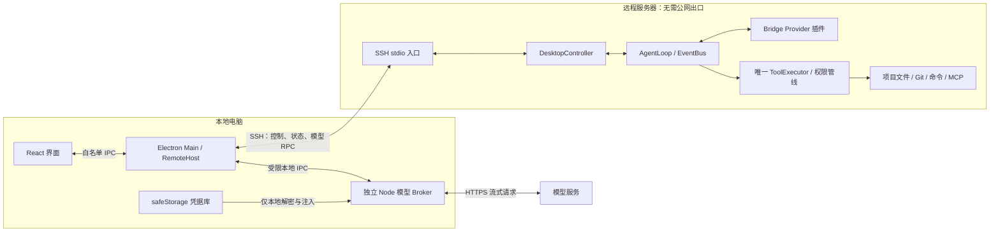
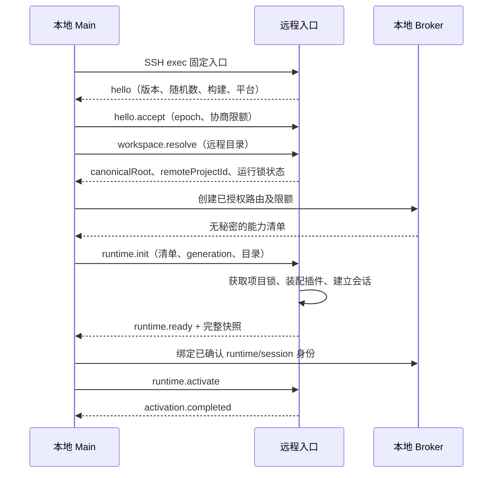
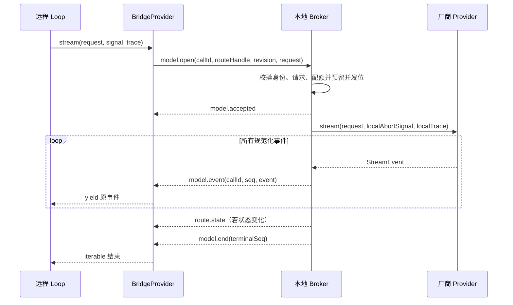
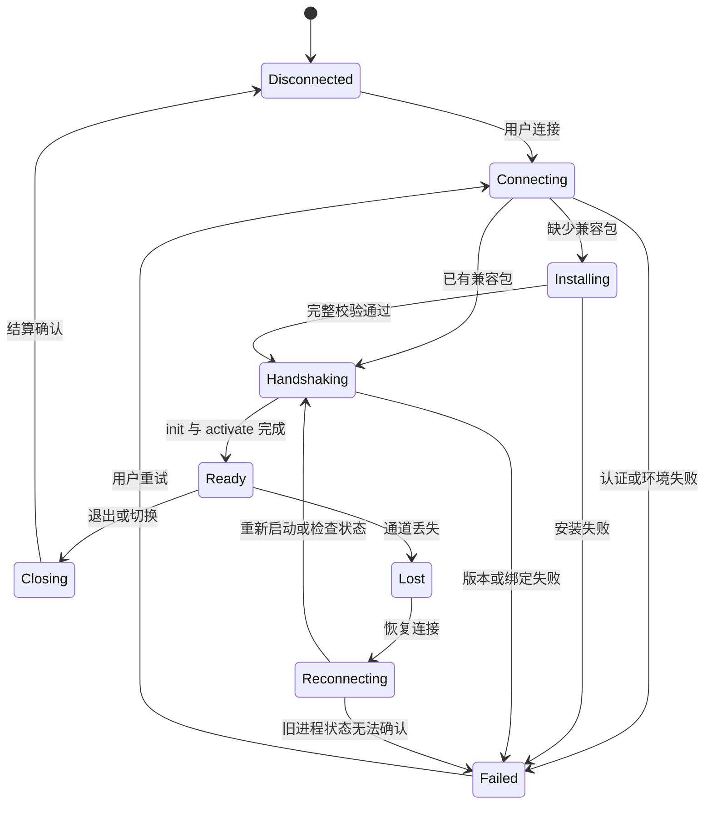

# Desktop SSH 远程 Agent 方案

状态：完整技术设计 v1.0；已完成首轮实现及 SSH/Electron 隔离验收，核对日期：2026-10-25。

实现状态与实际协议调整见 [SSH 远程工作区](../SSH-REMOTE.md)。下文保留原设计基线，其中拟议测试/接口不代表均按原名称创建；本轮以 pull 批次替代显式 credit 消息，复用 adapter 同步转换而非复制实现。上传字节进度、守护进程、完整签名发布等尚未实现，不能把整份设计的后续范围描述为全部交付。

本文的第 1—11 节说明架构选择与已有代码依据；第 12—24 节定义首版开发规格、协议、交互、故障恢复和交付顺序。所有新增接口、路径及默认值均为设计约定，不表示已有功能。

快速导航：[首版范围](#12-首版产品范围与用户流程) · [组件接口](#13-组件接口与依赖边界) · [双向协议](#14-协议-v1-详细规格) · [模型代理](#15-模型调用与预算的完整契约) · [配置示例](#16-配置与项目身份的具体规格) · [状态机](#17-连接运行和审批状态机) · [运行锁与恢复](#18-运行锁持久化与故障处理) · [部署](#19-离线部署与发布规格) · [界面](#20-界面状态与操作规则) · [测试](#22-测试矩阵与发布门槛) · [开发任务](#23-实施任务拆分与交付顺序)。

## 1. 结论与范围

可行。推荐采用 **本地 Desktop + 本地模型请求 Broker + SSH 双向协议 + 远程 Agent Worker**。

远程保存项目文件、执行 AgentLoop、权限策略、工具、MCP、skills 和会话；本地显示消息、处理人工审批、保存模型凭据，并调用模型 API。远程 worker 的 Provider 通过 SSH 请求本地 Broker，Broker 使用现有厂商 adapter 发起 HTTPS 请求，再把规范化流式事件送回远程。

前提是本机能通过 SSH 到达服务器，本机能访问所选模型端点；服务器能运行部署包，并拥有项目读写/执行权限。服务器无需主动访问公网。若服务器与本机完全没有网络通路，本方案不成立。

“远程无需公网”适用于 Agent 服务部署和模型调用。远程执行的 `pnpm install`、Git 拉取、联网 MCP 等仍需离线依赖、内网镜像或单独设计的网络能力，模型 Broker 不自动代理这些流量。参与推理的远程文件片段会经本地发送到模型服务，并非代码始终不离开服务器。

## 2. 当前代码为何适合

以下依据当前工作区（含已有未提交改动），不是仅依据旧版架构文档：

- `desktop/main/worker-host.ts`：现有 WorkerHost 已通过独立 Node 进程、request/reply、状态快照隔离运行时；可以抽出宿主接口，增加 SSH 实现。
- `desktop/worker/index.ts`：进程消息循环很薄，但目前依赖 `process.send` / `process.on('message')`，不能直接通过 SSH 启动就复用 IPC。
- `desktop/worker/controller.ts`：封装 createAgent、事件转展示、文件检查、会话恢复、审批 resolver；适合作为远程 controller 的主体。
- `desktop/shared/protocol.ts`：已有 action schema、generation、sessionId、invocationId、seq。可复用业务语义，但必须新增网络边界 schema 与连接身份。
- `src/core/provider.ts`：Provider 产出规范化 StreamEvent；不仅有 stream，还有同步的 modelCapabilities、normalizeRequest、requestBytes、estimateRequest 等方法。
- `src/runtime/create-agent.ts` / `src/builtin/default-preset.ts`：支持 preset 与 manifest/setup 插件装配。远程入口可换成代理 Provider 插件，core 不应引入 SSH、Electron 或具体 Broker。
- `src/builtin/provider-connections.ts`：命名连接会创建真实 provider，规划、压缩也能引用这些连接。不能只替换默认 openai/anthropic。
- `desktop/main/index.ts`：当前会在本机 realpath/stat 项目，并将 vault 解密后的 credentials 传给 worker；远程启动必须走独立分支，禁止复用该 credentials 消息。
- `desktop/main/project-catalog.ts`：当前要求 `id === path`，同路径跨主机会冲突。
- `desktop/scripts/build.mjs`：有随包 Node 与原生依赖打包基础，但产物属于当前平台，不能把 Windows 产物直接上传到 Linux。

现有边界减少了重构范围，但并不意味着只加一个 SSH 按钮就能完成。

## 3. 方案取舍

### A. 本地 loop，远程工具

本地运行 AgentLoop 与真实 Provider，read/write/bash 等通过远程工具服务执行。模型 API 本来就在本地，原型容易展示。

对本项目的代价是文件权限分析、真实路径、解释器、上下文收集、skills、MCP、会话目录都需要区分本地与远程。只给 bash 加一层 ssh，会让本地分析和远程执行使用不同环境。若将来只需要少量远程工具，这条路线仍合理；当前需求希望完整远程工作区，优先 B。

### B. 远程 loop，本地 Provider Broker（推荐）

远程继续使用真实远程 cwd、工具和权限执行门；把模型 I/O 移回本地。现有六个文件/shell 工具不必逐个重写为远程工具。需要实现双向 RPC、代理 Provider、配置拆分、部署与断线状态。

### C. 远程 loop，SSH 反向端口转发到本地 HTTP 网关

OpenSSH `-R` 支持把远程监听端口转发到本地服务，可用于快速概念验证。但网关仍需处理不同厂商协议、认证注入、流式取消和端点限制；不是“开一个隧道就自动能用 API”。还依赖服务端允许 TCP forwarding，远程回环端口也不能视为独占权限边界。[OpenSSH 文档](https://man.openbsd.org/ssh.1)

采用 B 可以直接使用本项目已有的 ChatRequest / StreamEvent，并通过 SSH exec 的 stdin/stdout 传输，不要求 `AllowTcpForwarding`。

## 4. 进程与数据流



示例：用户要求“读取 README 并修复一个问题”。

1. UI 提交任务，本地 RemoteHost 经 SSH 发送 submit；远程校验连接、会话、请求 ID 后启动 loop。
2. 远程收集项目上下文，BridgeProvider 发送规范化 ChatRequest 与会话内 routeHandle。
3. 本地 Broker 验证授权路由、模型、预算和请求大小，调用真实 Provider；key 仅在本地使用。
4. Provider 产生 StreamEvent，经 SSH 回到远程 loop。loop 聚合消息、发布事件，controller 再把展示更新送回本地。
5. 模型提出工具调用后，远程 ToolExecutor 完成参数校验、钩子、deny、危险检测和审批流程。
6. 如果需要人工审批，远程只发送展示 DTO 与 approvalId；resolve 函数和 AbortSignal 留在远程。用户决定经 SSH 返回，远程验证后一次性消费。
7. 工具在远程执行；结果进入远程上下文，并通过下一次 Broker 调用继续推理。文件预览、Git 检查同样通过远程 controller 的执行器。
8. 远程保存正式会话，本地更新展示与最近会话索引。

本地不要自行把 Broker 返回的文本当成已提交的 agent 消息；远程 loop 仍是会话与工具执行的权威状态源。

## 5. SSH 通道与协议

首版调用系统 OpenSSH，复用用户的 Host、IdentityFile、ssh-agent、ProxyJump 与 known_hosts。首版限定已经配置好的密钥/agent 登录；密码、MFA 与应用内首次信任向导留待后续。主机身份确认是首次连接流程的一部分，不是每次工具调用的新审批。

SSH 以 `-T` 启动固定远程入口，保留 stdin/stdout 做双向通信；日志走 stderr，工具子进程输出必须捕获，不能污染 stdout。OpenSSH 文档说明无 PTY 的会话可透明传输数据。[SSH 传输依据](https://man.openbsd.org/ssh.1)

本地使用 `spawn(sshExecutable, argv, { shell: false, windowsHide: true })`。这只能防止本地 shell 解释，SSH 的远程命令仍可能由远程 shell 解析；因此启动固定、正确引用的安装路径，项目 cwd、用户任务与配置全部放到握手后的 JSON 消息，不能拼入远程命令。对安装路径中的空格、单引号、换行做专门验证。

协议采用有版本的分帧 JSON 消息，并使用 RPC 风格的 request/result/error/event；物理帧与逻辑消息分离，具体见第 14 节。流式与取消扩展由本项目明确规定，不声称兼容标准 JSON-RPC。

必要消息（下列为拟议协议，不是现有 API）：

- `hello`：protocolVersion、buildId、平台/架构、能力、最大帧、连接随机数；严重版本不兼容直接拒绝。
- `runtime.init/submit/stop/resume/inspect/approve/dispose`：受限业务动作；远程 init schema 不包含任何 credentials。
- `runtime.snapshot` / `runtime.delta`：初始快照、连续展示变更；丢序后请求新快照。
- `model.open`：modelCallId、routeHandle、request、关联 ID；本地返回 accepted 或安全错误。
- `model.event` / `model.end` / `model.error` / `model.cancel`：按调用独立有序复用，保留模型 message_stop 与传输结束的区别。
- `model.trace`：经过脱敏和截断的 HTTP 调试副本，通过代理的 ProviderTrace 回调接入原有事件链。
- `heartbeat` / `lease.renew`：应用层活性、controller 租约。

Envelope 包含 connectionEpoch、runtimeId、projectId、sessionId、消息 ID；模型调用另带 callId 和 streamSeq。先完成 session 绑定再允许调用模型，不接受远程随意声明一个有效会话。

`modelCallId` 与当前 observedStream 创建的 requestId 不是天然相同：代理在本次 stream 闭包中保存 callId 与 trace 回调的关联，回调外层会自动带回原 requestId；不要求代理读取 core 私有 ID。若 Broker 需要角色诊断标签，可扩展通用 ProviderTrace 的可选关联元数据。主模型、planner、judge、compact、child 都需可区分且不重复统计用量。

双方都校验 schema、帧长度、字段大小、状态次序和关联身份，不信任 TypeScript 类型。执行流严禁悄悄丢事件；stdout 启动噪声应报清晰握手失败，不能无界扫描寻找 JSON。

**背压与展示：**当前 worker 约 50ms 发送完整展示快照，直接跨公网发送会随对话增长。首个原型可保留快照，但可用首版应改成初始/重连快照加有序增量，文本可小批合并；调试大正文按需分页。模型流采用有界队列和消费确认，慢接收方耗尽窗口时停止读取；取消/心跳预留控制队列，避免大调试帧阻塞停止操作。SSH/Node 的写入背压也必须落实。

## 6. BridgeProvider 与模型 Broker

远程新增 manifest/setup 插件，通过 `ctx.provide.provider()` 挂载所有允许的逻辑 provider，包括命名连接。使用远程 preset 装配，排除真实联网 Provider 和会自行实例化 adapter 的原命名连接插件；替换为只读路由目录与代理实现。不能重复注册后依赖覆盖顺序。

所有模型调用必须统一走代理：主 loop、规划、审批模型、压缩和子 Agent。远程 `.env` 仍可为远程工具提供环境变量，但代理不读取模型 key，不把远程 key/端点转交给本地，也不在 Broker 失败时退回远程直连。

### 不可忽略的同步接口

当前 Provider 的 modelInfo/modelCapabilities/normalizeRequest/requestBytes/estimateRequest 是同步方法，不能简单实现为异步 RPC。把现有 adapter 的无网络请求构建、能力检查和预算估算提取为 provider 层的共享纯函数模块；同版本发布到两端。远程握手获取经本地批准的路由能力快照、model specs 与 adapter 版本，在远程进程内计算这些同步函数。

真实 HTTP client 和凭据解析只在 Broker 构造。Broker 接收请求后重新验证预算及配置 revision，遇到能力/版本不一致明确失败，不静默修改后继续。远程保留原请求限额，Broker 另加宿主级消费上限。这部分是 B 相比简单 HTTP 隧道的额外工程量。

routeId、思考签名、redacted thinking、原始工具参数及其 source、缓存断点和 usage 都按现有协议完整传输，不只转发文本。逻辑路由名、实际端点身份和工具参数来源身份分别保留，不能把 routeId 全部替换成 `ssh`，否则会破坏缓存/回放来源检查。

### Broker 的授权边界

- 本地可信用户选择连接后创建仅对当前连接/会话有效的 routeHandle，映射到批准的 provider、端点、模型集合和预算。
- 远程不提供任意 URL、HTTP method、headers、apiKeyRef 或本地文件路径；禁止通用 fetch/CONNECT 代理。
- 本地 endpoint/config revision 改变后重新装配，旧 handle 撤销；只在本地使用实际端点对应凭据。
- Broker 只加载本地可信的模型连接配置和 adapter，不能加载远程项目上传的插件、hooks、MCP 或 `.env`。
- Key 在本地 main 的 safeStorage 中保存，按需交给受限本地 Broker 进程；不出现在 renderer、SSH 参数、远程 init 或远程日志中。继续拒绝不可用/basic_text 后端。safeStorage 是本机存储保护，并非进程内明文永不可读。[Electron safeStorage](https://www.electronjs.org/docs/latest/api/safe-storage)
- 并发数、累计 token、请求大小、速率上限在本地校验，防止远程插件通过授权路由无限消耗本地模型额度。

这里的安全假设是用户信任所连接主机及获准运行的远程插件。远程 root 可改写远程执行器，本方案不提供对恶意远程操作系统的可信执行保证；本地路由限制仍能减少凭据泄露和任意本地请求面。

## 7. 项目身份、配置与持久化

### 项目身份

项目类型改成 local/ssh 判别联合。远程记录至少包括 hostProfileId、SSH 身份绑定、remoteCanonicalRoot、显示名与最近 sessionId。本地远程工作区 projectId 使用稳定 UUID，并绑定主机档案、远程账号和远程规范化根目录，不能只用 `/srv/repo` 或可随意改名的 SSH alias。

SSH host key 的验证交给 OpenSSH；应用把连接档案解析后的目标变化作为重新绑定事件，不静默复用原远程工作区，合法证书/密钥轮换按 SSH 信任配置处理。相同机器不同账号应视为不同执行环境。远程返回 POSIX 路径，本地 Windows 不调用 path.resolve/realpath/stat 去解释它。

远程原有 SessionManager 可以保留自己的项目 ID；本地索引把它放在主机命名空间下，避免多主机碰撞。远程会话是正式记录，本地可持久化只读展示缓存，明确标为缓存，不能自动覆盖远程历史。

### 配置分域

- **本地连接配置：**SSH 档案、模型连接/端点、凭据、允许模型、Broker 限额；保存在本机。
- **远程项目配置：**权限规则、cwd、工具、MCP、skills、规划配置、模型 ID 偏好与会话；保存在远程。
- **会话授权清单：**本地向远程提供允许的逻辑 route、能力与规格，作为当前会话的宿主约束；不是新的一份万能配置。

两个域分别保留原有默认/全局/项目/SDK 覆盖规则，不把本地 global 和远程 global 不加区分地混成一个层级。远程项目引用不在本地授权目录里的连接，应显示“需要映射本地连接”，不能自动采用远程 baseURL。

`/model`、`/mode`、`/think` 仍保存远程项目，先保存成功再应用；模型选择限于已授权路由。项目切换/模型设置的 CAS 和未知字段保留语义不变。UI 显式标注“本机模型连接”“远程项目设置”“远程用户默认”；两端写入不是单事务，需映射两端状态后再创建会话。

## 8. 断线、取消与恢复

**首版目标：断线安全结算并能恢复已保存会话，不承诺正在生成的模型响应无缝续传。**

1. 正常停止：UI 发 stop；远程 abort 当前 loop；BridgeProvider 发 model.cancel；本地中止 SDK 请求；远程等待工具和会话保存结算后反馈。不能在按下按钮瞬间显示“已全部停止”。
2. SSH 断开或租约过期：本地撤销路由并取消所有关联模型请求；远程停止派发新工具，取消模型等待/审批和当前执行，尽力结算保存。远程必须有自身心跳期限，不能只等本地 TCP 判断断线。
3. 本机显示“连接中断，远程状态待确认”。网络分区下无法保证远程瞬间停止，已经发生的外部副作用也无法撤回；后台逃逸进程不因 SSH 关闭就必然退出。
4. 重新连接：重新握手，分配新 connectionEpoch；读快照/会话状态后恢复展示。首版 stdio worker 可能已经退出，重新启动后只能恢复持久化会话，不能把它描述为重连原进程。
5. 旧审批、旧取消、旧模型流全部失效；若后续重新产生审批，使用新 ID。不能把上一条连接上的 allow 移交给新会话。
6. 网络动作统一增加 operationId 去重；submit 与现有 invocationId 一一关联，approve 保留已有一次性 approvalId 语义。当前进程缓存结果，跨进程检查依赖持久化操作日志。崩溃后结果不明时明确标为未知，不自动重发写入/bash；一般外部副作用无法提供全局 exactly-once。
7. 模型响应必须收到原协议 message_stop 才算完整；传输 EOF、model.end 或重连不等于模型成功结束。半条 tool_use 不能执行。

后续若要“网络短断后重新挂接仍运行的进程”，增加远程守护进程、受限 Unix socket、controller 单写租约、事件日志与 checkpoint。守护进程只能等待/保存可恢复状态；本地 Broker 不在线时仍无法继续新的模型推理。要关掉本地后持续推理，必须改用常在线 Broker 或远程直连，是不同部署模式。

## 9. 远程安装与支持矩阵

安装包在本机下载/随 Desktop 提供，通过 SFTP/SCP 上传到远程用户目录，例如 `~/.agentlab/remote/<buildId>/<platform-arch>/`。本地校验发布清单与包哈希，远程校验传输完整性后解压到临时目录并原子切换；保留上一版本。校验目标路径、归档路径穿越与异常符号链接；已有连接不在运行中替换文件。

包应包含兼容 Node、worker bundle、所需原生模块与 LICENSE，不在远程运行 curl、npm install 或编译依赖。当前 tree-sitter 系列存在原生依赖，必须为目标平台、架构、ABI/libc 制作并验证产物。Windows 本机可以上传 Linux 包，但不能直接复用自己的 node.exe 和原生模块。

建议首版限定 Linux x64/glibc 与经过验证的一组发行版，之后增加 Linux arm64。握手检测 OS、arch、运行时和系统库兼容性；准确最低 glibc/kernel 以所选固定 Node 发布版为准。可用仓库许可对应的版本作为验证起点，不能把 Node main 分支要求硬套到 Node 22。[Node v22.23.2 构建支持说明](https://github.com/nodejs/node/blob/v22.23.2/BUILDING.md)

Git、构建工具及自定义 MCP 可执行程序按功能检测并提示缺失。VS Code Remote-SSH 也采用本地/远程拆分，支持本机下载服务端后传输；这一点证明“远程安装无需公网”的部署思路可行，不代表本应用复用 VS Code Server。[VS Code 官方说明](https://code.visualstudio.com/docs/remote/ssh#_what-are-the-connectivity-requirements-for-the-vs-code-server-when-it-is-running-on-a-remote-machine--vm)

## 10. 最小改造清单

原设计的文件与职责规划（实际落点和首轮实现状态见使用文档）：

- `desktop/main/runtime-host.ts`：提取 request/dispose/订阅与连接状态接口；保留现有本地 WorkerHost。
- `desktop/main/ssh-host.ts`：OpenSSH 生命周期、握手、上传、RPC、连接状态；不承载工具权限决策。
- `desktop/shared/remote-protocol.ts`：双向 schema、帧编码、版本与流状态约束；远程 init 与本地 init 分离。
- `desktop/remote/index.ts`：stdio 远程入口；复用 controller，通过可注入 channel 替代 process IPC。
- `desktop/broker/index.ts`：本地模型请求工作进程与受限路由调度；main 保持 UI/凭据/IPC 职责。
- `src/providers/bridge.ts` 与 `src/builtin/provider-bridge.ts`：代理实现、manifest/setup 注册。
- `src/providers/` 下共享纯请求构建/估算模块：两端同步 Provider 契约一致性。
- 远程专用 preset：保留工具、策略、reviewer、planner、compactor、会话等；替换 Provider、命名连接及连接设置能力。
- `desktop/main/project-catalog.ts` / `desktop/shared/protocol.ts` / renderer：项目位置判别联合、远程连接 UI、状态/审批绑定。
- 远程包构建脚本：按受支持平台生成可离线安装的版本化服务包。

原有 CLI 路径继续使用默认 preset。新能力通过 manifest/setup 和现有 pluginEntries 装配，不增加另一套插件配置别名；SSH 宿主属于 Desktop 层，core 不依赖它。

## 11. 建议实施顺序与验收

**阶段 1：隔离环境验证协议闭环。** 先用两个 Node 进程和 FakeProvider 验证双向 RPC、代理所有模型角色、远程工具、流式显示、审批/取消与 requestId 归属。尚不涉及 SSH 登录和真实 key。

**阶段 2：Linux SSH 可用首版。** 增加离线上传、OpenSSH 宿主、远程项目 UI、本地凭据 Broker、连接中断结算、有限快照/增量传输；维持现有同一时间一个活跃顶层会话。

**阶段 3：长会话与恢复增强。** 守护进程、重挂接、持久化命令日志、展示缓存、多主机并发、密码/MFA 向导。是否需要这些能力，由首版真实使用反馈决定。

最低验收：

1. 在受控 SSH 测试机禁用公网出口，仅允许既有 SSH 通道；本地 mock API 可完成远程读取、修改、命令和多轮 AgentLoop。
2. main/planner/judge/compact/child 分别触发模型请求，全部到本地 mock；不存在远程直连 fallback。
3. 验证两端请求规范化、模型规格、预算、思考、缓存、原始工具参数与 usage 一致；未知能力明确报错。
4. SSH 转录、远程文件、日志、renderer state 均不含测试 key；远程不能选择任意本地端点或读取凭据。
5. 在模型流中途、待审批、工具运行中、写入完成但 reply 丢失时切断连接；旧审批失效，半成品不执行，未知结果不重放。
6. cancel 能取消本地 SDK 请求并结算远程执行；断网 UI 不冒充已确认停止。
7. 两台主机相同目录不混淆；Windows 本机/Linux 远程路径、空格路径、符号链接和越界读取均覆盖。
8. deny、危险命令、明确 ask、文件预览/Git 检查仍走唯一 ToolExecutor；模式切换不自动消费审批。
9. 大消息、慢消费者、并发子 Agent、帧损坏、重复 ID、过期 epoch、协议版本不符有界处理；控制消息不被大正文长期阻塞。
10. 远程包无 Node/无网络安装、已有包复用、哈希不符、原生模块缺失/架构不符均给出明确结果。
11. 后续代码实现必须运行 `pnpm typecheck`、`pnpm test`，再完成 SSH 集成验收。全部回归使用隔离 HOME/临时项目/固定假 key/mock，不连接真实模型服务。

最初研究阶段没有连接真实服务器、调用真实模型或修改应用实现；后续已完成首轮代码与隔离 SSH/Electron 验收，具体结果见使用文档。性能、平台兼容和未覆盖故障仍按相应验收范围判断，不从单机验证推断全部支持。

## 12. 首版产品范围与用户流程

### 12.1 首版必须交付

- 本地 Windows Desktop 连接 Linux x64/glibc 远程服务器；本地 OpenSSH 与已配置的密钥/ssh-agent 可用。
- 使用 SSH Host alias，支持由用户 SSH 配置定义的端口、身份文件和 ProxyJump。
- 本地获取或缓存远程服务包，经 SFTP 上传、验证、安装、复用；服务器无 Node、无公网出口也可启动。
- 手动输入远程项目绝对路径；连接后展示主机、远程根目录、会话和能力状态。
- 同一时刻一个活跃顶层会话；该会话已有的子 Agent 功能保留。
- 通过远程现有工具读取/修改文件、执行非交互命令、加载远程项目上下文与本地 stdio MCP。
- 本地展示完整流式消息、工具结果、计划、子 Agent 状态与审批，支持停止。
- 文件列表/搜索/预览与现有 Git 差异检查在远程执行，遵守原有范围与限制。
- 本地配置模型、保存 key、代发全部模型角色请求；远程没有模型凭据也可完成闭环。
- 保存/恢复远程会话；连接丢失后明确标注未知状态，恢复前核对运行锁和最后持久化状态。
- 保留现有本地项目与 CLI 的使用方式。

### 12.2 首版不包含

完整 VS Code 编辑器、LSP、断点调试、文件监听同步、远程端口预览、交互 PTY 终端、多顶层会话并发、远程 Windows/musl、密码/MFA 向导、跨客户端无缝接管、断流续传和无人在线持续推理。

这里的“像 VS Code”指连接远程工作区的产品体验。现有 bash 工具不是交互终端；现有 Git 检查也不是完整 Git 客户端。不把这些扩展混入首版发布条件。

### 12.3 用户流程

1. 首页先“添加主机”：输入 SSH Host alias 和可选名称，验证并保存独立主机记录，此时不创建项目。
2. 点击主机的“打开项目”；项目位置可选择本机或已添加主机。远程目录浏览支持进入子目录、上一级和输入路径后转到。
3. 选好目录后打开项目，展示“验证连接 → 检测环境 → 上传/复用服务 → 启动服务”的阶段及可操作错误。
4. 远程执行所选目录的规范化/权限检查，回传真正 projectRoot，确认 UI 与实际根一致。
5. 选择本地已配置模型连接，并映射远程引用的逻辑 Provider。已有映射有效时直接复用，无需每次重复操作。
6. 创建远程运行时，返回工具/插件/模型能力；恢复最近已保存会话或新建会话。
7. 正常聊天、预览、审批、停止与本地项目一致；顶部始终显示远程身份。
8. 切换项目时，当前任务先停止并结算保存；失败则保留当前状态供处理，不假装切换成功。

目录浏览在用户明确选择已保存主机后，通过专门的只读 SSH 目录服务完成；模型和 Agent 文件检查仍走工具权限管线。目录服务只枚举目录，不读取文件内容，不借用安装用的 SFTP 接口。

## 13. 组件接口与依赖边界

### 13.1 RuntimeHost

本地主进程只依赖宿主接口；本地版继续包装原 WorkerHost，SSH 版负责连接与远程消息。以下 TypeScript 为接口草案：

```ts
type RuntimeTarget =
  { kind: 'local'; canonicalPath: string } | { kind: 'ssh'; profileId: string; remotePath: string };

type TransportStatus =
  | 'disconnected'
  | 'connecting'
  | 'installing'
  | 'handshaking'
  | 'ready'
  | 'reconnecting'
  | 'closing'
  | 'failed';

interface OperationReceipt {
  operationId: string;
  status: 'accepted' | 'completed';
}

interface RuntimeHost {
  readonly target: RuntimeTarget;
  connect(signal: AbortSignal): Promise<void>;
  request(action: DesktopAction, signal?: AbortSignal): Promise<OperationReceipt>;
  onSnapshot(listener: (snapshot: RuntimeSnapshot) => void): () => void;
  onStatus(listener: (status: TransportStatus) => void): () => void;
  close(reason: 'switch' | 'quit' | 'user'): Promise<void>;
}
```

初始化不作为 renderer 可任意调用的普通 action。main 完成目标选择、凭据授权及清单建立后，使用内部工厂初始化宿主。原有 request(): Promise<void> 的调用点可由 main 适配；UI 不能把 accepted 当作任务完成。

### 13.2 Controller 与通道

`DesktopController` 继续接收业务 action、拥有 Agent 和审批 resolver。抽出最小通道适配：发送快照/增量/安全错误，监听关闭；controller 不知道传输是进程 IPC 还是 SSH。已有 `process.on('message')` 留在本地入口，远程入口改用协议 dispatcher。

禁止把整个 EventBus 序列化：包含函数、AbortSignal 或内部对象的事件必须先变为 DTO。只转发确有用途的展示、诊断和控制消息。

### 13.3 Broker 与 Provider

Broker 是本地独立 Node 进程，main 负责凭据解密和连接授权。Broker 复用受控 Provider 工厂，而非调用完整 createAgent；它不装配工具、远程 plugins、skills、MCP 或会话存储。

远程 BridgeProvider 只做协议翻译；本地 Broker 的授权、限流、生命周期决策属于宿主服务。Provider 内不加入工具批准或执行逻辑。

### 13.4 preset 的具体改造

在 `src/builtin/` 把默认 preset 的组合过程拆成可替换的 provider/连接设置部分与共享的工具/权限/上下文/会话部分。远程 preset 显式传入代理 provider 集合及远程设置能力。

不要在远程入口按插件 ID 长期维护一长串过滤名单，也不要改变全局注册表的“重复注册失败”规则。内置与外部插件都仍经 manifest/setup。

远程首版只允许支持代理契约的 Provider；其他类型的普通插件仍可运行在远程，但自带直连网络逻辑不会被自动代理。未知自定义 Provider 给出明确不支持信息，不能虚报完全离线可用。

## 14. 协议 v1 详细规格

### 14.1 连接与握手顺序



init 仅装配，activate 之前拒绝 submit 与模型请求。插件 onActivate 若尝试提前请求模型，明确失败；首版不支持启动期自动推理插件，避免会话尚未绑定就开放路由。

### 14.2 物理帧与逻辑消息

每个物理帧使用 `4 字节大端长度 + UTF-8 JSON`，长度不含自身 4 字节。首版物理帧上限 64 KiB；双方可协商更小值。此处的 KiB/MiB 均按 1024 计算。

普通小消息直接入帧，大逻辑消息使用 begin/chunk/end：chunk 携带 transferId、index 与 base64 数据，单片原始数据不超过 40 KiB。end 校验累计字节数与 SHA-256 后才解析业务 JSON。base64 仅为统一帧格式，不提供保密性；保密由 SSH 提供。

初始建议限额：单个逻辑模型请求 16 MiB、单个展示快照 8 MiB、每方向累计重组缓冲 32 MiB、并行重组最多 4 个。以上为工程初值，不覆盖更严格的现有 request/tool 限额；超限明确失败，不静默裁剪实际模型上下文。调试大正文分页、截断标记单独处理。

重组超时默认 30 秒无进度，立即释放内存；心跳不能为无进度传输续期。禁止分配对端声明的超大数组后再验证；禁止嵌套 chunk、重复 index、跨 epoch 拼接及无界 JSON 深度。

每发送一片都回到调度器，控制消息优先。已写进操作系统管道的数据无法被抢占，所以还需限制实际 write 队列，尊重 `write() === false` 与 drain，而不是仅添加一个“高优先级”字段。

### 14.3 消息信封

```ts
interface WireEnvelope {
  version: 1;
  kind: 'request' | 'result' | 'error' | 'event';
  messageId: string;
  replyTo?: string;
  epoch: string;
  method: string;
  binding?: {
    runtimeId: string;
    projectId: string; // 远程 projectId；本地映射到主机命名空间
    sessionId: string;
    generation: string;
  };
  payload: unknown; // 实现时逐 method 用严格 schema 解析
}
```

hello 是唯一可不带 epoch 的预握手消息，使用独立 schema。未知 version/kind/method、越权方向和缺失 binding 都拒绝，不用可选字段掩盖阶段约束。

### 14.4 方法方向与应答语义

- 本地 → 远程：workspace.resolve、runtime.init/activate、submit、stop、approve、inspect、resume、settings 操作、snapshot.get、operation.get、dispose。
- 远程 → 本地：model.open、model.cancel；只在已激活 runtime 和当前会话授权范围内接受。
- 远程 → 本地事件：runtime.snapshot/delta、operation.completed/failed、会话生命周期。
- 本地 → 远程事件：model.accepted/event/trace/end/error、路由状态更新。
- 双向基础控制：ping/pong、lease.renew、flow.credit；不授予新业务权限。

submit、inspect、settings commit 等长操作先返回 operationId/accepted，之后发完成事件。stop 接收确认与 stop 完全结算是两件事。审批可同步完成 ID 消费，但工具完成另由运行状态反馈。

每个改变状态的动作携带稳定 operationId；相同 ID/相同内容返回已知状态，相同 ID/不同内容报 `OPERATION_CONFLICT`。动作受当前 epoch/runtime 绑定约束，操作日志按工作区/session/operationId 保存，重连后只允许查询自己已绑定会话的旧记录，不通过旧 ID 自动重放。动作载荷 hash 不包含传输时间戳；submit 的 operationId 与现有 invocationId 一一关联。

`flow.credit` 使用绑定 callId/transferId 的单调累计已消费字节数；重复确认无效、回退或超过已发送字节数的确认报错。接收确认表示已通过校验并进入有界消费管线，不代表已执行工具或保存会话。取消和终态释放未用窗口，不能被迟到确认恢复。

错误消息固定为 code、safeMessage、scope（connection/runtime/operation/call）、可选关联 ID 和 retryAdvice（none/reconnect/reconfigure/checkOutcome）；不直接透传异常对象、stack、SDK response 或原始 SSH stderr。初始错误码包括 PROTOCOL_MISMATCH、HOST_UNTRUSTED、AUTH_FAILED、UNSUPPORTED_PLATFORM、INSTALL_INTEGRITY_FAILED、PROJECT_BUSY、ROUTE_UNAVAILABLE、ROUTE_STALE、FRAME_LIMIT、REQUEST_LIMIT、OPERATION_CONFLICT、OUTCOME_UNKNOWN、SAVE_FAILED。retryAdvice 只供 UI 提示，不是自动重试指令。

### 14.5 展示增量

初始快照包含 runtimeId、generation、sessionId、stateSeq。后续 delta 带 baseSeq/seq 和有类型操作，例如 row.appendText、row.upsert、approval.add/remove、runtime.status、usage.replace、plan.replace。

收到重复 seq 丢弃；baseSeq 不匹配就停止应用该批增量并请求快照，不能盲目套用 JSON Patch。快照切换会话时清空文件缓存、旧审批与输入关联；草稿按本地 projectId/sessionId 单独保留。

文本 50—100ms 合并；审批出现/撤销、工具终态、错误、会话保存完成立即发送。完整历史不需要全部进入每次快照，保持当前展示窗口，历史/调试按需分页。

### 14.6 初始超时与流控参数

- SSH 建连 15 秒；启动/握手 30 秒；上传使用“30 秒无进展”超时并显示字节进度。
- 控制请求 accepted 应答 10 秒；任务执行时长使用自身配置，不用同一个 RPC timeout 杀掉所有长任务。
- 心跳每 5 秒一次，应用租约 20 秒未续约进入失联结算；重连不复活已失效租约。
- 模型首事件等待 120 秒，无事件等待 120 秒，单调用上限 15 分钟作为可配置初值；有些模型长时间推理不返回增量，需按连接适当调整。
- 模型流初始未确认窗口 512 KiB/调用，方向总排队 8 MiB；达到上限停止拉取上游，超时则明确取消。
- 这些参数均待压力与弱网测试调整；不能将其描述为已经测得的性能。

## 15. 模型调用与预算的完整契约

### 15.1 RouteDescriptor

每个路由的无秘密快照包含：逻辑 providerName、routeHandle、providerRouteId、wireSourceRouteId、adapterKind、adapterBuildId、semanticsRevision、允许模型、模型能力、contextWindow/maxOutputTokens、有效 dialect、缓存选项和 Broker 限额。

providerRouteId 保留命名连接层身份；wireSourceRouteId 保留 adapter 为原始工具参数标记的来源身份。不要把二者强制合一。端点与凭据绑定仍只在本地 Broker 内部保存，远程不需要拿到可请求的完整 URL。

远程 models.json 可提出规格与默认值，实际会话按本地授权的路由规格计算；不一致必须在装配结果中明确展示或阻止启动，不能双方各算各的。指定模型不在清单时先完成本地连接配置再重新装配。

### 15.2 同步方法的一致性

提取 ProviderSemantics 纯逻辑，接收上述描述和请求，提供 normalizeRequest、modelCapabilities、requestBytes、estimateRequest。远程 BridgeProvider 和本地真实 Provider 使用同一实现；两端版本与 semanticsRevision 必须一致。

远程负责执行预算与压缩，Broker 负责再次验证、授予路由与宿主级额度。Broker 不再调用另一套默认 normalizeModelRequest 去偷偷填充不同 maxTokens；收到的是远程已准备请求，校验失败则明确报错。

当前 Anthropic adapter 还有 cacheDisabled 一类运行期状态。实现时必须处理它：若请求处理改变可影响后续请求构建的状态，本地在本次 model.end 前发送 `route.state` 与新 revision，远程先应用再允许下一次调用。首版可对同一有状态 adapter 路由串行化，保证不存在旧 revision 的并发新调用；不能只在握手同步一次就宣称请求字节始终一致。

### 15.3 stream 生命周期



accepted 不代表厂商已经收到请求或已经计费。Broker 为 callId 维护终态，end/error/cancel 竞争时只落一次终态；迟到 chunk 不进入新调用。

收到 message_stop 后仍按 provider 实际顺序转发允许的 usage 等尾事件；只有 stream 正常结束且结束语义完整才成功。传输中断或 model.error 必须使 iterator 抛错，而不是模拟正常 EOF。

取消发生在 open 尚未 accepted 时也记录取消意图，Broker 接收 open 后检查；不能因控制帧先到而遗漏取消。iterator.return()、signal.abort、断链都必须回收 call 队列和本地 AbortController。

### 15.4 多角色、限流与重试

- main/planner/judge/compact/child 使用统一 Provider 注册与身份映射。子会话建立由 controller 事件显式关联根 runtime；角色标签不能授予额外权限或绕开总额度。
- 远程仍负责实际 Agent 用量与会话累计；Broker 的 usage 仅用于本地额度核对和诊断，不再作为第二份 model_usage 回填。
- 首版建议每个 runtime 最多 4 个排队/执行中的模型请求、每条有状态路由最多 1 个执行；值可配置，排队公平且可取消。
- SDK 重试由本地 adapter 统一管理并记录 attempt；SSH 协议层绝不自动重发已受理的 model.open。已经出现响应片段或接收结果未知时，不从头请求来伪装续传。
- 本地累计额度采用“请求前预留、结束后按已报告 usage 结算”；上游缺失 usage 标记 unknown，不当作零消耗释放全部预算。token 估算不是精确货币账单，不能宣称精确费用封顶。
- Reviewer 的原有字节/token 上限继续有效；其他角色也沿用现有预算规则。Broker 额度是附加上限，不能放宽原权限或预算。

## 16. 配置与项目身份的具体规格

### 16.1 本地宿主档案

建议在 Electron userData 下增加版本化的 `remote-hosts.json`，它是 Desktop 宿主状态，不是新的 Agent 插件配置入口。采用原子写、CAS、未知字段保留；不存密码、key、完整环境变量或模型消息。

示意 JSON（占位 ID，不是可直接使用的真实连接）：

```json
{
  "version": 1,
  "profiles": [
    {
      "id": "ssh-profile-01",
      "name": "开发服务器",
      "sshTarget": "dev-server",
      "revision": 1
    }
  ],
  "workspaces": [
    {
      "id": "remote-workspace-01",
      "profileId": "ssh-profile-01",
      "requestedPath": "/srv/projects/demo",
      "canonicalRoot": "/srv/projects/demo",
      "remoteProjectId": "remote-project-id",
      "providerMappings": [
        {
          "remoteProvider": "openai",
          "localConnection": "my-local-model-connection"
        }
      ]
    }
  ]
}
```

providerMappings 的 remoteProvider 是远程现有 provider 字段或辅助插件 provider 字段的引用，localConnection 指向本地已存在的命名连接；不在映射里复制 baseURL/apiKeyRef。routeHandle 每次建立连接重新生成，只存内存，不持久化为可复用凭证。

### 16.2 远程配置保留原格式

远程 `agent.config.json` 仍通过 provider/model、pluginConfig、pluginEntries 等原入口表达偏好。不要把 SSH 地址或本地 key 写进去，不增加 `remoteProvider` 一类兼容别名。

配置决议顺序：

1. 远程按既有层级解析项目/远程用户默认，获得主模型和各角色需要的逻辑 provider/model。
2. 本地按 workspace 映射找到本地连接，解析实际端点及凭据，仅给出无秘密描述。
3. 映射缺失、模型不支持、必要规格冲突时停在配置阶段，列出具体缺口；不自动按同名猜连接。
4. 将批准描述注入远程 preset，保持远程逻辑 providerName 稳定，使现有角色选择和持久化正常工作。
5. 远程修改 /model、/think 时只允许当前描述支持的值；换 Provider/端点或增加模型需要空闲时重新装配。

现有远程 `.env` 只在规范化根目录按原规则加载，仍供远程工具使用；Broker 不读它。远程已有 apiKeyRef 不会传到本地解密，也不会触发本地凭据 fallback。

### 16.3 主机身份

使用稳定 profileId 标识用户创建的连接档案；连接时以本机可信 SSH 配置解析目标（主机/端口/账号/跳板链）并生成档案解析 revision。目标变化时要求重新绑定工作区，不能只凭 alias 名继续复用。

OpenSSH 负责 known_hosts/主机证书验证。首版不把解析 `ssh -v` 日志作为验证主机指纹的必要依赖，也不信任 worker 自报指纹作为安全凭据。服务器报告的 hostname、安装实例 ID 仅用于显示和重装提示。正确配置的主机证书/密钥轮换不应被一个自制指纹比较机制误判。

本地工作区 ID 是本地稳定 UUID，并记录上述绑定及远程 canonicalRoot/账号；远程 SessionManager 保留原路径 hash。SSH 档案删除只删除本地连接记录，不删除远程文件或会话。

### 16.4 远程用户默认设置

全局设置主入口继续默认操作本机。远程用户级设置通过远程项目内的明确入口打开，范围标注“远程用户：账号@主机”；不得把它显示成普通“全局”后写到用户意料之外的机器。远程 Provider 凭据设置不提供保存入口，统一跳转本机连接映射。

## 17. 连接、运行和审批状态机

连接状态和 Agent 运行状态分别维护，不能用 busy 一个字段表达全部：



运行状态：idle → running → waitingApproval/running → stopping → settling → idle；异常可进入 interrupted 或 saveFailed。此状态属于宿主展示协议，不要求把 transportLost 硬塞入 core 的 AgentRunResult。

只有 Ready 且 idle 才可 submit/resume/切模型配置；running 时允许 stop、已有审批反馈和有界只读调试。文件检查若现有 controller 不允许并发，应沿用限制，不因远程化开启额外执行并发。

审批 ID 在远程创建，状态 pending → allowed/denied/cancelled/expired，只能迁移一次。网络不连通时本地按钮禁用；模式切换不迁移审批状态。审批绑定需包含 generation/session/epoch；远程仍重验执行环境是否已变化。

## 18. 运行锁、持久化与故障处理

### 18.1 三类锁与租约

- 项目运行锁：远程同一用户、同一 canonicalRoot 首版只允许一个 Desktop runtime 拥有工具执行权，避免两个客户端同时修改。不同项目允许各自连接，但当前本机 UI 仍只激活一个。
- Controller 租约：该 runtime 只受一个当前 epoch 控制；心跳超时撤销连接授权并进入停止结算。
- 会话存储锁/CAS：沿用现有 SessionManager 的保存与恢复约束，防止会话文件并发覆盖。

项目锁可采用独占创建的锁目录与 owner 记录，保存 instanceId、PID、进程启动标识和构建信息。不能仅凭 PID 存在或文件 mtime 超时判断存活；Linux 上核对进程启动标识，无法确认则返回 PROJECT_BUSY，不自动抢锁。新的连接不得仅因旧租约过期就开始另一个 loop。

锁只协调遵守本协议的 Desktop runtime，并不阻止 shell、编辑器或旧 CLI 改动同目录，也不是 OS 沙箱。若将来要求 CLI 同样互斥，应将执行租约抽成通用宿主能力，单独设计兼容行为。

### 18.2 持久化目录与日志

沿用远程 `~/.agentlab/state/projects/<remoteProjectId>/`：sessions 保存正式会话；新增 remote 子目录保存锁及运行恢复元数据，operations 保存协议操作日志。安装包位于独立 remote/releases 路径，卸载运行包不触碰会话状态。

操作日志只记录操作 ID、请求摘要 hash、run/session ID、受理/结算状态和时间，不默认复制完整 prompt、文件正文或凭据。状态变更写盘失败时，不执行尚未开始的变更动作；结束日志失败标为 outcomeUnknown，并保留会话证据。

首版持久化 submit 的受理记录与结束记录，防止重连误提交整轮；审批只在存活进程中一次性消费，重启全部失效。这里不实现每个外部副作用的事务日志，也不保证崩溃后准确知道 shell 是否执行了一半。

### 18.3 停止与断线

有序关闭先撤销新请求 → abort 模型/待审批/工具 → 等待已有操作结算 → flush 会话/操作日志 → 释放运行锁 → 回复关闭。模型 Broker 关闭必须同时取消全部子会话调用。

远程可取消受管子进程组，但不能保证恶意或自行 daemonize 的程序被清除。超过取消等待期限后标记 unsettled，阻止正常新任务；用户查看远程状态后才能决定后续，不把强制杀 worker 等同于完整回滚。

睡眠/网络分区触发租约到期也按此处理。本机恢复后先查询快照/运行标记，再展示可继续的已保存会话；不自动恢复上次 submit 或补发 allow。

### 18.4 故障处理清单

- **SSH 认证失败：**显示账号/目标与安全错误，提示配置密钥或 agent；不读取输出中的秘密，不改成关闭主机验证。
- **未知/变化的 host key：**遵循 OpenSSH 拒绝结果，进入信任配置流程；不能用 `StrictHostKeyChecking=no` 自动绕过。
- **安装中断：**已验证发布目录不受影响；下次清理本应用的临时上传或重新上传，不运行半包。
- **模型 key/端点失败：**由本地连接设置处理，远程会话保留；不尝试远程 `.env` key。
- **模型额度不足：**拒绝新的模型调用；已有工具不会因此自动回滚，按当前请求结算展示。
- **流中途断开：**本次响应失败；完整 message_stop 之前的工具调用不得执行。
- **工具完成但 reply 丢失：**查 operation 和会话状态，无法证实时显示未知，不重做。
- **会话保存失败：**显示 saveFailed；正常关闭/切换受阻，允许重试保存或显式处理退出，保留已知内存状态。
- **Broker 崩溃：**当前调用失败并撤销对应 handle；重启 Broker 后只服务新操作，不重放旧模型请求。
- **worker 崩溃：**本地读取最后缓存但标为失联；确认旧锁失效后重建 runtime，恢复最后落盘会话。
- **协议损坏/超限：**结束该连接、回收缓冲和路由，输出固定错误码；不把原始帧显示到错误弹窗。
- **远程磁盘满：**安装阶段失败不激活；运行日志/会话保存失败明确报告，阻止声称已持久化。

## 19. 离线部署与发布规格

### 19.1 包格式

建议远程包包含 manifest.json、node/bin/node、worker/index.mjs、必要 node_modules、LICENSES。manifest 声明 buildId、protocolVersion、providerSemanticsVersion、Node 版本、OS/arch/libc、文件清单及 SHA-256、包大小、解压大小上限。

首版由本地可信发布清单固定包 hash；后续在线更新由签名清单校验发布者。只从远程反馈一个 hash 并不能证明下载包来源可信。Node 运行时及其 native addon 应在对应 Linux 构建环境产出并 smoke test。

### 19.2 安装步骤

1. 使用固定、经过引用的检测脚本确认远程架构、用户 HOME、临时空间、tar/sha256 校验能力；检测不能依赖尚未部署的 Node。
2. 本机匹配受支持包并完成来源/hash 校验。没有可用包就显示不支持；不临时在服务器联网构建。
3. 经 SFTP 上传固定安装目录下的 `.partial` 包，验证实际大小与 hash。SFTP batch 使用参数/路径专用编码，不能直接拼接用户输入。[SFTP 官方说明](https://man.openbsd.org/sftp.1)
4. 在本应用受控用户目录内验证所有归档路径后解压到临时目录，拒绝绝对路径、路径穿越、外指符号链接/硬链接及超限膨胀。
5. 运行包自检：Node 版本、加载三个 tree-sitter 原生模块、协议 hello、无网络 FakeProvider 小回路。
6. 原子发布到 releases/<buildId>/<platform-arch>；该进程始终用具体不可变版本路径启动，不跟随可被中途切换的 current 链接。
7. 保留一个已验证旧版本；运行中版本不可清理。清理仅限通过解析和归属检查的本应用目录。

### 19.3 SSH 选项

建议 exec 使用 -T、BatchMode=yes、StrictHostKeyChecking=yes、ForwardAgent=no、ClearAllForwardings=yes、ServerAliveInterval=10、ServerAliveCountMax=3，并设连接超时。保留 stdin，不能使用 -n。具体选项须在目标 Windows OpenSSH 版本完成兼容验收。

本地 ssh-agent 可以用于认证，不代表把认证 agent 转发给服务器。ProxyJump 仍依赖跳板的正常 SSH 转发能力；“应用无需远程端口监听”不表示所有跳板限制都能绕过。

若 SSH 配置有 RemoteCommand、RequestTTY 或产生 stdout 噪声的登录脚本，需检测冲突并给出可定位错误。用户维护的 SSH config 是本地可信输入，其中 ProxyCommand/Match exec 可能执行本地程序；远程项目内容不得决定或覆盖这些设置。

### 19.4 支持和升级策略

首版准确版本锁定：Desktop、远程 worker、ProviderSemantics 使用同一 buildId；已有包不匹配时上传匹配版本。先不用复杂跨版本兼容层。会话文件仍按原格式版本校验，无法降级读取时保留文件并报错。

首版验收至少覆盖 Windows 本机 + Ubuntu 22.04/24.04 x64 远程候选环境；此为计划矩阵，只有测试通过的组合才写入发布支持列表。macOS 本地、arm64 远程分别增加原生验收，不能凭 TS 构建成功宣称支持。

## 20. 界面状态与操作规则

项目卡片显示远程标识、用户可读主机名、目录、最近连接状态。会话顶部持续显示“SSH · dev-server · /srv/projects/demo”，避免把远程命令误认为本机执行。

连接中的 UI 显示当前阶段与取消按钮；安装显示已传输字节/总字节，不编造总耗时估计。取消上传不删除已安装版本。

聊天输入区区分“运行中”“正在停止”“正在保存”“连接中断”。同一存活运行时仅收到远程结算确认才恢复正常发送；旧进程已退出时须经恢复检查确认没有待处理的未知结果。草稿可继续编辑，离线时不静默排队自动发送。

审批卡片增加远程主机/账号/目录；正文保持完整参数、风险与理由。断线或审批失效立即禁用，UI 不保留一个能在新连接上复用的允许按钮。

文件面板显示远程路径和读取时刻，失败保留旧内容并标为缓存；切换主机/会话时清空关联。首版仅支持当前已有文件预览，不加入未经设计的直接 SFTP 编辑。

模型选择显示“请求由本机发送”，连接设置跳转本机模型页面；远程项目设置和远程用户设置分别标范围。保存行为沿用自动提交规则；一次保存成功才应用，不增加统一 Save 页面或二次确认。

错误页面提供“重连”“查看诊断”“打开本机模型设置”等针对性操作。运行结果未知时仅提供检查/恢复已保存会话，不提供默认选中的“重新执行上次任务”。

后续增加直接编辑器时，新增受 ToolExecutor 约束的写入工具，带读取版本 hash 做 CAS；不要把远程文件保存变成旁路 writeFile RPC。交互终端应作为独立能力设计，不混入模型 RPC。

## 21. 诊断、安全与性能目标

### 21.1 诊断关联

每次连接记录 connectionEpoch、runtimeId、buildId、profileId；每次操作记录 operationId；模型记录 callId、route revision 和映射到原有 trace 的关联。只在远程产生一份 Agent 业务事件，本地 Broker 产生实际 HTTP trace，经脱敏回调归属到同一请求。

记录连接/握手/安装阶段耗时、SSH RTT、队列长度、缓冲字节、模型首事件耗时、取消结算耗时、快照与增量字节数。默认只存元数据；调试正文沿用当前脱敏和截断规则，不能把完整模型请求夹在连接错误日志中。

导出报告包含版本、阶段、错误码、必要关联 ID 与用户选择的脱敏调试记录。不得导出 SSH 私钥、认证环境、密钥库内容、routeHandle 或原始 HTTP authorization。

### 21.2 必须保持的安全属性

- renderer 沿用固定 preload 白名单和 IPC sender 校验，没有任意 ssh/exec/fetch 接口。
- 本地 Broker 仅接收 main 传入的已绑定消息，不通过无认证 localhost 服务暴露 key。
- 远程项目只能影响远程插件装配；不能要求本机 import 远程 JS。
- 显式 deny/ask、危险检测、模型审批失败回退和唯一 ToolExecutor 仍生效。
- 项目文件权限判断在远程真实平台完成；本地不能预先把路径当成已授权。
- 本方案没有给远程执行额外增加内核沙箱；恶意远程主机与插件的任意代码执行不在可信边界内。

### 21.3 可测量目标

以下是验收目标，不是实测结论：

- 模型正文流分片不再等待完整回答才展示；正常条件下远程收到事件到展示队列输出的应用合并等待不超过 100ms，网络延迟单独统计。
- 100ms RTT、1% 丢包、10 Mbit/s 的受控环境中，消息顺序正确、队列有界、停止控制不被持续调试正文饿死；总停止时间仍取决于网络和工具结算。
- 运行时快照不随全部历史无限增长；长会话主要传增量，调试正文按需读取。
- 连接失效后最多一个租约周期加调度余量内远程开始停止，不把它作为强制终止所有外部进程的 SLA。
- 大请求超过限额应在发起真实 API 前失败；不发生无界内存重组或只因 UI 慢就无限缓存模型事件。

## 22. 测试矩阵与发布门槛

### 22.1 测试层次

**单元层：**帧解析、拆包粘包、chunk 重组、schema、信封状态次序、队列背压、取消竞态、稳定身份、配置映射、route revision、纯 ProviderSemantics 一致性。

**双进程集成层：**真实 Node 入口经管道通信，隔离 HOME/项目，FakeProvider 驱动 read/edit/bash/审批/子 Agent/规划/压缩。模拟 EOF、坏帧、重复/错序消息和 Broker 崩溃。

**SSH 集成层：**受控容器/VM 的 sshd，固定测试主机密钥与测试账号；连接配置只在临时 HOME。远程公网出口禁用，本地模型端点用 mock。验证全新安装/复用/中断/版本不符与运行锁。

**Desktop 端到端层：**真实 Electron 点选远程项目、显示阶段、流式消息、审批、停止、恢复、模型设置与文件预览。记录截图及机器可读断言，不只靠肉眼确认。

### 22.2 必测故障注入点

在 hello 之前、init 之后/activate 之前、submit 受理前后、model.accepted 前后、tool_use 参数半包、message_stop 前后、审批允许前后、工具副作用已完成但应答丢失、会话保存期间、关闭结算期间分别断开 SSH。

每个点验证：是否调用过模型、是否执行过工具、是否保存会话、旧 ID 是否失效、是否错误重放、是否错误显示已完成。不能只断网一次就声称恢复链路全部覆盖。

### 22.3 回归文件建议

- `tests/remote-framing.test.ts`：长度/分片/粘包/重组/上限。
- `tests/remote-protocol.test.ts`：方法方向、握手、绑定、重复动作、取消竞态。
- `tests/provider-bridge.test.ts`：所有 StreamEvent、trace、正常/错误/取消终态。
- `tests/provider-semantics-parity.test.ts`：两端实际请求构建、预算和动态缓存状态一致。
- `tests/remote-model-roles.test.ts`：五类模型角色与命名连接都走代理。
- `tests/remote-config.test.ts`：配置分域、模型映射、key 不跨边界、CAS。
- `tests/remote-runtime-lock.test.ts`：进程存活、PID 重用、锁无法确认、重复连接。
- `tests/remote-recovery.test.ts`：受理日志、未知结果、会话冲突和保存失败。
- `tests/remote-install.test.ts`：包完整性、路径/符号链接限制、原生依赖检测。
- `tests/ssh-host.test.ts`：系统 ssh 参数、无本地 shell、固定入口、路径编码、错误分类。
- `desktop/scripts/remote-smoke.mjs`：隔离 SSH + mock API 的真实 UI 验收。

以上是任务规划，尚未创建这些测试文件。实现时按真实边界编写测试，不为静态转发函数堆叠镜像测试。

### 22.4 发布门槛

必须通过 `pnpm typecheck`、`pnpm test`、Desktop 构建及远程包构建；完成受控 SSH 离线闭环、主机身份失败、敏感值扫描、审批回归、运行锁和所有关键故障注入。发布清单记录具体 OS/arch/Node/buildId 与证据目录。

整个回归不能使用用户真实 `.env`、key、主机配置或生产项目；本地 fake key 必须能在转录/远程文件中检出泄漏。所有模型请求指向进程内 mock 或测试本机服务，不访问真实模型 API。

## 23. 实施任务拆分与交付顺序

每个阶段交付可审查的代码、说明和验证证据；依赖顺序不能由 UI 先行掩盖后端未完成。

### M0：冻结首版契约与提取宿主边界

工作：确定 RuntimeHost、目标类型、remote schema 与版本；将 WorkerHost 包装成 LocalRuntimeHost；controller 对接可注入通道。涉及 main/worker-host、worker/index、shared/protocol、controller。

完成标准：本地功能行为不变，现有 Desktop 测试通过；没有 SSH 实现也可以通过内存通道运行 controller。不得在 core 加入 transport 分支。

### M1：提取 ProviderSemantics 与本地 Broker

工作：提取无网络 adapter 逻辑；实现可信本地 Provider 工厂、路由授权、凭据注入、预算/并发/取消与 trace；覆盖命名连接及运行期缓存状态。

完成标准：mock 验证原 adapter 与提取后的请求/事件一致；任意 URL、未授权模型、错 revision、旧 handle 被拒绝；renderer/远程 DTO 不含 key。

### M2：远程 preset 与管道闭环

工作：BridgeProvider 插件、远程入口、模型双向消息、运行时初始化/激活、完整模型角色代理、快照增量和流控。

完成标准：两个 Node 进程完成多轮读取→审批→修改→验证→保存；planner/judge/compact/child 全覆盖；取消和破损流不执行半条工具调用。

依赖：M0、M1。可在此阶段演示功能，但不能称为 SSH 产品完成。

### M3：SSH 宿主与离线部署

工作：系统 OpenSSH/SFTP、Linux 发布包、检测/上传/校验/启动、known_hosts 失败分类、项目身份及安装复用。

完成标准：无 Node、无公网出口的受控 Linux 主机可由本机部署并完成 M2 闭环；平台/ABI 不符明确失败；不依赖远程 npm/curl。

### M4：运行锁、恢复和操作日志

工作：项目运行锁、controller 租约、submit 受理日志、结算状态、旧 ID 拒绝、重连核对、保存失败处理。

完成标准：关键故障注入全通过；两客户端不会通过协议同时运行同项目；结果未知的写入与模型请求不自动重放。此阶段是发布前置，不能作为可选“稳定性优化”。

### M5：Desktop 产品入口与验收

工作：远程项目向导、连接阶段、路由映射、主机标识、远程设置范围、审批失效展示、断线草稿和缓存状态。

完成标准：用户从新主机档案开始完成整个流程；现有本地项目/CLI 回归通过；真实 Electron + 受控 SSH 截图、断言和构建产物齐备。

### 后续增强

M6 才引入远程 daemon/Unix socket、单控制端重挂接与事件日志；M7 引入多主机/多顶层会话、公用 Broker 多租户限额；M8 再考虑编辑器、PTY、端口预览和 LSP。各能力有独立权限面与生命周期，分别设计和验收。

不在当前阶段承诺固定日历工期：尚未完成跨平台 native 包、动态 ProviderSemantics 和故障恢复原型。先以 M0—M2 的实际实现结果评估后续工作量，避免把“SSH 连通”估算成全部工程量。

## 24. 最终决策与实施前提

本方案已经确定：远程 loop、本地 Broker、系统 OpenSSH exec、无额外远程应用监听端口、插件化代理 Provider、远程会话权威、本地凭据权威、首版精确版本匹配、断线取消并恢复已保存会话。

后续开发无需重新讨论这些基本方向。真实接入时需要提供目标主机的 OS/arch、SSH 认证方式、项目路径和目标模型连接；这些信息影响部署与配置，不阻碍先用隔离环境完成 M0—M2。

本方案的首版完成定义是：**用户在本地 Desktop 中，通过 SSH 操作一个没有公网出口的远程项目，完整执行带工具和审批的 AgentLoop，全部模型请求经本机发送；发生断线时不会误批准或盲目重复操作，并能恢复已保存会话。**
